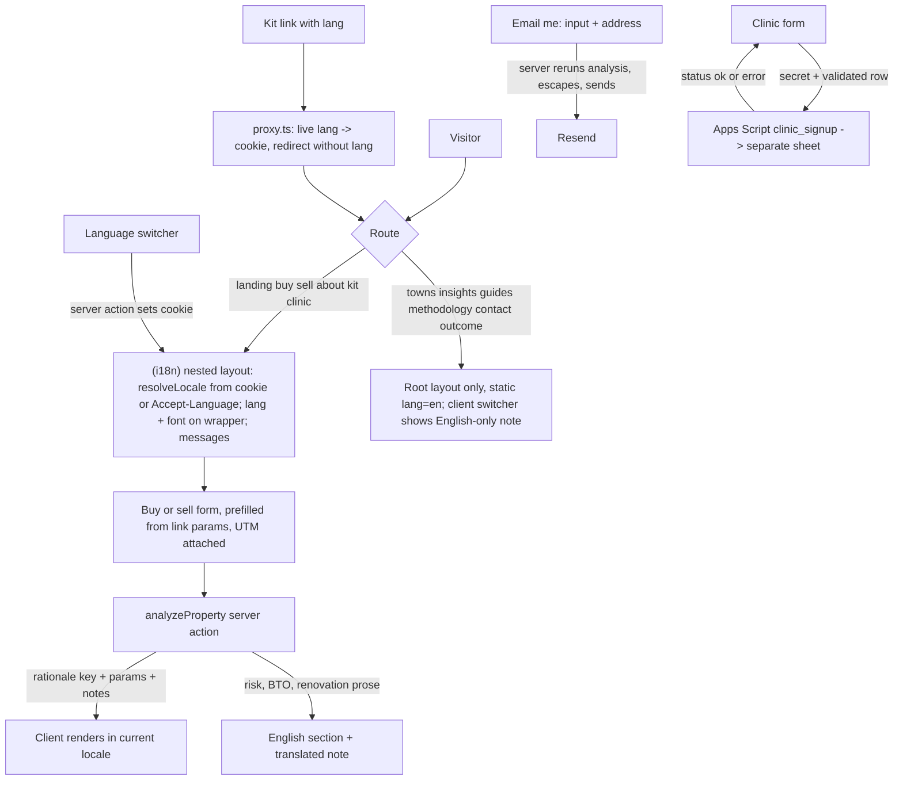

# feat: SGHaus phase 1 for the SG Partnerships Fund Seed application

**Target repo:** `geraldngkk/sghaus`, worked from an off-Drive clone (the Drive working tree has `src/`, `public/` and `scripts/` deleted; see origin, Dependencies).

## Overview

Phase 1 turns sghaus.com into a free community tool a grant reviewer can recognise, before Gerald applies for the Seed tier. It removes the email gate and the sales push, rewrites the positioning and About story, adds Chinese, Malay and Tamil for the main flows, and launches two online community pieces: the help-your-parents kit and the clinic page. Phase 2 (grant-funded) is out of scope here.

## Problem Frame

The site reads like a startup funnel: a forced, undismissable email modal on every result, seller emails titled "Ready to list?", "Don't wing it" in the headline, and lead scoring behind the scenes. The fund "does not fund commercial projects" and tests whether a project is citizen-led and engages other citizens (see origin: Problem Frame). Gerald confirmed SGHaus will not be commercialised and that he applies as an individual living in Singapore.

## Requirements Trace

Phase 1 scope from the origin phasing table:

- R1-R6 positioning and copy (headline, "Free for every Singaporean", founder story, no new disclaimer, no named sources, no Beta badge)
- R7-R8 no gate, optional "Email me this report"
- R9-R12 four languages for landing, buy and sell flows with **core** results, kit, clinic and About; fluent review before a language goes live
- R13 "How we work out the numbers" page (English in phase 1)
- R17, R25 help-your-parents kit with WhatsApp hand-off and prefilled links
- R18 (first part), R19, R26 clinic page with first date, sign-up and listing submission, all states
- R20 lead scoring off and no listing hand-off; R21 collection notices on every form that collects an email or listing; R22 clinic data handling (separate sheet, redaction, recording notice, 90-day deletion)
- R23 language behaviour; R24 mobile header and homepage community section; R27 text and touch sizes
- Phase 1 also pauses any current email that pushes listing or urgency (origin: Phasing)

## Scope Boundaries

- Not in phase 1: R14 new guides, R15 offer evaluation, R16 full email rewrite, the monthly clinic series and recordings, translation of the methodology page and guides.
- **Results translation is partial (Gerald, 25 Nov 2026):** the form, the three offer cards with their reasons (including MRT, school and renovation notes), costs and net proceeds are translated. Risk flags, the decision checklist, market context, the BTO supply notes, the renovation questions and the negotiation panel stay English in phase 1, each with a one-line note in the reader's language, and move to phase 2.
- **Existing disclaimers stay (Gerald, 25 Nov 2026):** the boxes on buy, sell and About are kept and reworded so no data source is named. No new disclaimer is added.
- **The report email stays English in phase 1** (Gerald, 25 Nov 2026), with a translated line next to the button saying so.
- Town, insights, guides, contact and outcome pages stay English.
- No monetisation, in-person events, outcomes board or translator programme (origin: Scope Boundaries).

## Context & Research

### Relevant Code and Patterns

- Gate: `src/components/email-capture.tsx` (forced modal, `setTimeout`, `localStorage["sghaus-email-captured"]`), mounted at `src/app/buy/page.tsx` and `src/app/sell/page.tsx` with `delayMs={12000}`.
- Report email: `src/actions/send-report-email.ts` takes the whole `AnalysisResult` from the client and sends immediate, +48h and +14d emails via Resend `scheduledAt`; `src/lib/emails.ts` interpolates block, street and risk titles into HTML and subjects with no escaping. Listing and urgency pushes: seller +48h "Ready to list", "List here and negotiate down", buyer +48h "Ready to make your offer", and "Need help ... Get in Touch" CTAs.
- Apps Script writers: `src/actions/subscribe.ts` (sends no `type`), `contact.ts`, `submit-outcome.ts`, `log-analysis.ts`. All report success on failure or missing env. `subscribe.ts` and `send-report-email.ts` log raw email addresses.
- UTM: `src/lib/utm.ts` keeps UTM in `sessionStorage`; `analyzeProperty` is called from `src/components/property-form.tsx` without it, and `src/actions/analyze.ts` calls `logAnalysis` without it.
- Result prose: `src/lib/offer-calculator.ts` rationales; `src/actions/analyze.ts` appends MRT, school and "Renovation-adjusted" notes to rationales with string concatenation; seller rationales are built client-side in `src/app/sell/page.tsx` (`deriveSellerPricing`); English-only sections come from `src/lib/risk-assessment.ts`, `src/lib/constants.ts` `BTO_SUPPLY_MAP`, `src/lib/bto-estates.ts`, `src/lib/renovation.ts`, `src/lib/negotiation.ts`. About 49 mechanical "em dash to comma" joins and about 140 em dashes (many in comments) sit in `src/lib`.
- `AnalysisResult` carries finished English prose and is saved to `localStorage` (`src/lib/storage.ts`, `sghaus_saved_analyses`).
- Share links: `src/lib/share-url.ts` encodes `t,f,s,b,st,a` (a is floor area); `decodeAnalysisUrl` returns null without `t` and has no callers. `src/components/property-form.tsx` loads blocks with `getBlocks(town, flatType, street)` and resets street, block and storey whenever town or flat type change, so prefill must walk the cascade. `useSearchParams` needs a `Suspense` wrapper (pattern: `src/app/outcome/page.tsx`).
- Layout: `src/app/layout.tsx` holds metadata (metadataBase, verification, icons, OG, Twitter), JSON-LD, Google Analytics, `globals.css`, DM Serif Display and Hanken Grotesk (latin only) and `<html lang="en">`. "Don't wing it" sits in `layout.tsx` (description), `src/app/page.tsx` (h1) and `src/app/opengraph-image.tsx`. `src/components/header.tsx` is a shared server component with six `text-xs` mobile links and no menu.
- Content-page kit: `src/app/guides/_components/guide-ui.tsx`. Form state machine pattern: `src/app/outcome/page.tsx` (`idle`/`submitting`/`success`/`error`).
- Rendering: `/`, `/about`, `/buy`, `/sell`, guides are static; towns, insights and feeds are ISR (`revalidate = 86400`). Any server-side cookie read in a layout or component they share makes them dynamic.
- Source-name leaks: disclaimers in `buy/page.tsx` and `sell/page.tsx`, About ("We collect data from various data sources"), `analyze.ts` error "from HDB data".
- Exposure: `src/app/api/test-emails/route.ts` (unauthenticated GET that sends the email sequence to any `?to=`), `src/app/api/test/route.ts` (debug), `src/app/api/analyze/route.ts` (public GET running the full pipeline on Gerald's upstream keys; no caller in the repo). `src/actions/analyze-seller.ts` is dead code, so its strings are removed rather than translated (this lowers the origin's string count).

### Institutional Learnings

- Apps Script source is not in the repo; the live version is the standalone `openById` script. Unknown `type` values fall through to the subscriber branch, so deploy the script before any app change that sends new types.
- Redeploy with Manage deployments, pencil, New version to keep the URL. New `MailApp` or trigger use needs one manual Run to grant permission.
- The script returns HTTP 200 with `{status:"error"}` on failure; callers must read the body.
- `appendRow` turns values starting with `=`, `+`, `-`, `@`, tab or carriage return into formulas.
- Lead scoring exists only in Apps Script (`updateLeadScore()`, `Lead Scores` tab); whether it was ever deployed is unconfirmed.
- Social platforms cache OG images; flush Facebook's Sharing Debugger and Telegram's @webpagebot after changing them.
- Pushing to `master` auto-deploys to Vercel project `app` (team `geraldngkahkian-5500s-projects`).
- Brand: never name a data source, no em dashes, plain Singaporean English; `/buy` and `/insights` titles keep "HDB Price Checker" and "HDB Price Trends".

### External References

- next-intl 4.16.2 supports Next 16 (peer `next ^12 ... ^16`); cookie-only setup: https://next-intl.dev/docs/getting-started/app-router/without-i18n-routing
- Next 16: `cookies()`/`headers()` are async; `middleware.ts` is now `proxy.ts`: https://nextjs.org/docs/app/guides/upgrading/version-16
- next/font metadata: Noto Sans SC has no Chinese subset entry (use `preload: false`; glyphs arrive as `unicode-range` slices); Noto Sans Tamil has a `tamil` subset.

## Key Technical Decisions

- **next-intl with the locale in a cookie, no URL prefix.** A `[locale]` segment would remount the flow on switch and lose inputs and results (R23) and would change English URLs. Cost accepted: the other languages are not separately indexed.
- **One root layout stays; translated pages sit in a route group with a nested layout.** `src/app/(i18n)/` holds landing, buy, sell, about, kit and clinic under a nested layout that reads the locale, provides messages, sets `lang` and the locale font class on its wrapper, and updates `document.documentElement.lang` on the client. The root layout, its metadata, analytics, OG image, 404 and every other route are untouched, so towns, insights and guides keep static or ISR rendering. Chosen over two root layouts, which would have meant duplicating metadata, analytics and OG images and adding a global 404 (plan review, 25 Nov 2026).
- **The shared header reads no cookie on the server.** The language switcher and the "this page is in English" note are client components that read the cookie in the browser and import a small static string map, so (site) pages stay static.
- **`proxy.ts` applies the kit's `lang` parameter before render.** For `/buy`, `/sell`, `/help-your-parents` and `/clinic`, a live `lang` value is written to the cookie and the request is redirected without it, so the first render is already in the parent's language and prefill runs once. An explicit `lang` link overrides a saved cookie.
- **First visit:** cookie if set, else the first live `Accept-Language` match, else English (R23). Resolution lives in a pure `resolveLocale` function.
- **Launch gate per language:** `LIVE_LOCALES` lists languages that passed fluent review (R12). Missing or unreviewed keys in a live language fall back to English at runtime (next-intl `getMessageFallback`), and the parity check reports them instead of failing the build, so copy edits never push unreviewed drafts live.
- **Core results return codes, not prose.** A rationale becomes `{ key, params, notes }`, where notes are MRT, school and renovation codes. The client renders them in the current language; numbers are formatted outside messages with the existing `en-SG` formatter so prices stay identical (R11). The report email renders the same codes server-side in English.
- **Untranslated result sections** keep their English prose and show one translated line saying the section is in English for now. Saved reports from before the change keep their stored prose.
- **Email-me builds its email on the server.** The action receives the property input and the address, reruns the analysis server-side, and builds the email from that, never from client-sent result data. Every interpolated value in `emails.ts` is HTML-escaped. This closes the open-relay risk.
- **Apps Script is the trust boundary.** Every server-side post carries a shared secret (Vercel env var and Apps Script Script Property); the script rejects mismatches, re-validates lengths and types, neutralises formula prefixes on every row it writes (analysis and UTM included), and reads spreadsheet IDs from Script Properties. Nothing secret is committed.
- **Abuse controls:** a honeypot on every form, per-IP rate limiting for the email-me and clinic actions through a Vercel Firewall rule, and server-built email content. The clinic platform uses registration or a waiting room so a leaked join link doesn't admit anyone.
- **No personal data in logs:** actions log outcome and type only.
- **Emails pause, not rewrite:** the immediate report email loses its listing and "Get in touch" lines, the +48h and +14d emails stop being scheduled, and any already queued in Resend are cancelled at deploy.
- **Fonts:** Noto Sans SC (`preload: false`) and Noto Sans Tamil, attached only for the active locale, placed after Hanken so Latin text and digits stay in Hanken; `.price-display` keeps Hanken tabular figures.
- **Tests:** Vitest for pure logic, plus a build-output check that (site) routes stay static or ISR; flows are checked in the browser at 390px, including a real WhatsApp tap for the kit.
- **Translations:** Claude drafts Chinese, Malay and Tamil from the English catalogue; a fluent speaker per language reviews with a short checklist (natural wording, no data source named, numbers unchanged) before the language joins `LIVE_LOCALES`.

## Open Questions

### Resolved During Planning

- Locale in URL or cookie: cookie, with `proxy.ts` handling kit links.
- One root layout or two: one, with a nested layout for translated pages.
- How results switch language without resubmitting: codes plus parameters.
- Where clinic data lives: separate sheet via a new script type with a shared secret.
- `/api/analyze`: no caller in the repo; deleted with the other exposed routes.
- Existing disclaimers: kept, reworded without the source (Gerald).
- Results translation depth: core results only in phase 1 (Gerald).

### Needs Gerald

- Names and consent of at least two volunteer co-hosts for the About page.

Decided by Gerald on 25 Nov 2026: apply once English and at least one other language are live (the rest marked "review in progress" and funded in phase 2); the report email stays English in phase 1 with a translated note.

### Deferred to Implementation

- Live clinic platform and the first date: Gerald chooses; the page reads both from one config value and shows the "coming soon" state until set.
- Whether lead scoring was ever deployed: read the live script before editing.
- Exact message key names and catalogue layout.
- Whether Hanken Grotesk exposes a `tnum` feature: check in the browser.

## High-Level Technical Design

> *This illustrates the intended approach and is directional guidance for review, not implementation specification. The implementing agent should treat it as context, not code to reproduce.*

## Implementation Units

- [ ] **Unit 1: Test harness and clean-up**

**Goal:** Add a test runner and remove exposed and dead code before reviewers look.

**Requirements:** supports all; R5

**Dependencies:** None

**Files:**
- Modify: `package.json` (Vitest dev dependency, `test` script, `check:static` script)
- Create: `vitest.config.ts` (with the `@/` alias), `scripts/check-static-routes.mts` (parses the `next build` route table and fails if any towns, insights, guides or methodology route stops being static or ISR)
- Delete: `src/app/api/test-emails/route.ts`, `src/app/api/test/route.ts`, `src/app/api/analyze/route.ts`, `src/actions/analyze-seller.ts`
- Test: `src/lib/share-url.test.ts`

**Approach:**
- Node environment; tests sit next to the file they cover; server-action tests mock `@/lib/resend` and `fetch`.
- Confirm nothing imports the deleted files; record the current build route table as the baseline for `check:static`.

**Test scenarios:**
- Happy path: `encodeAnalysisUrl` then `decodeAnalysisUrl` round-trips town, flat type, street, block, storey and floor area.
- Edge case: decoding a URL with no `t` returns null.

**Verification:**
- Tests and `check:static` pass on the unchanged app; the three API routes return 404.

- [ ] **Unit 2: Apps Script and form plumbing**

**Goal:** Switch off lead scoring, add the clinic record type, make the script the trust boundary, stop silent failures and get UTM into the log.

**Requirements:** R19, R20, R21, R22

**Dependencies:** None (the script is redeployed before Unit 7 merges)

**Files:**
- Create: `apps-script/Code.gs` (copied from the live editor, then edited), `apps-script/README.md` (deploy steps, Script Properties, retention)
- Create: `src/lib/sheets.ts` (shared poster: adds the secret, reads the JSON `status`), `src/lib/form-safety.ts` (length limits, email check, formula neutralising, honeypot)
- Modify: `src/actions/subscribe.ts` (`type: "subscribe"`, no address in logs), `src/actions/log-analysis.ts` (neutralise every value, UTM included), `src/actions/analyze.ts` (accept UTM and pass it to `logAnalysis`), `src/components/property-form.tsx` (send `getUtmParams()` with `analyzeProperty`)
- Test: `src/lib/form-safety.test.ts`, `src/lib/sheets.test.ts`

**Approach:**
- Script: remove `updateLeadScore` calls; check the shared secret first; reject unknown types; handle `subscribe` explicitly; add `clinic_signup` writing to a separate Gerald-only spreadsheet with text-formatted columns; neutralise formula prefixes on every write; read spreadsheet IDs and the secret from Script Properties; add a daily time-driven trigger that deletes clinic rows 90 days after their clinic date.
- Redeploy as a new version on the existing deployment so `GOOGLE_SCRIPT_URL` stays the same; add the secret to Vercel production only.
- `sheets.ts` returns success only when the body says `ok`; clinic and email-me use it and surface errors; analysis logging stays fire-and-forget.

**Execution note:** Implement `form-safety` test-first.

**Patterns to follow:** the `{ success, error? }` action return shape in `src/actions/*`.

**Test scenarios:**
- Happy path: a valid name, email and listing pass validation unchanged.
- Edge case: values starting with `=`, `+`, `-`, `@`, tab or carriage return are stored as literal text; a value over its length limit is rejected.
- Edge case: a filled honeypot is rejected without calling the script.
- Error path: a 200 response with `{status:"error"}`, a network failure, and a missing `GOOGLE_SCRIPT_URL` each yield `success: false` for clinic and email-me.
- Integration (live script, once): a post without the secret is rejected; an unknown `type` adds no row; a `utm_campaign` of `=HYPERLINK("x")` lands as text.

**Verification:**
- A test clinic sign-up lands only in the separate sheet; the subscriber tab and Lead Scores are untouched; lead scoring no longer runs; an analysis from a `utm_source=kit` link shows `kit` in the Searches row.

- [ ] **Unit 3: Positioning, copy and access without barriers**

**Goal:** Remove the gate and the sales push, close the email relay, and land the new English copy.

**Requirements:** R1-R8, R20 (listing hand-off), R21, phase 1 email pause

**Dependencies:** Unit 2

**Files:**
- Delete: `src/components/email-capture.tsx`
- Create: `src/components/email-report.tsx` (optional inline "Email me this report" with notice line, honeypot and states), `src/lib/escape-html.ts`
- Modify: `src/actions/send-report-email.ts` (takes property input plus address, reruns the analysis on the server, sends the immediate report only, no address in logs), `src/lib/emails.ts` (escape every interpolated value; remove "List here", "Need help ... Get in Touch" and other listing lines)
- Modify: `src/app/buy/page.tsx`, `src/app/sell/page.tsx` (remove gate, add email-report, keep calling `captureUtmParams()` on mount, reword disclaimer without source)
- Modify: `src/app/page.tsx` (headline, "Free for every Singaporean"), `src/app/layout.tsx` (description), `src/app/opengraph-image.tsx`
- Modify: `src/app/about/page.tsx` (founder story, audience, named volunteer co-hosts once Gerald supplies them, reworded disclaimer)
- Modify: `src/app/contact/page.tsx`, `src/app/outcome/page.tsx` (R21 notice line)
- Modify: `src/actions/analyze.ts` (error text without "HDB data")
- Test: `src/lib/copy-rules.test.ts`, `src/lib/escape-html.test.ts`, `src/actions/send-report-email.test.ts`

**Approach:**
- The report email is sent only when the person types an address and presses the button; no timers, no modal, no localStorage gate.
- About: the founders, in their thirties, watched their elderly parents take an agent's word at face value and risk losing money to agents who wanted to close fast; who SGHaus is for (origin R3). Every factual line comes from Gerald; nothing invented.
- `copy-rules.test.ts` strips comments and scans string literals and JSX text in an explicit list of files cleaned so far (this unit's files); Unit 5 adds the lib files it cleans and Unit 4 adds the catalogues. It flags em dashes, "--" and banned source names, allowing the approved "HDB Price Checker" and "HDB Price Trends" titles.
- Deploy step: cancel every Resend email still scheduled from the old +48h and +14d sequence, and confirm none remain.

**Test scenarios:**
- Happy path: the copy scan passes on the listed files; the fixture with an em dash or "data.gov.sg" fails it.
- Happy path: `escapeHtml` turns `<script>` and quotes in a street name into entities.
- Error path: `sendReportEmail` given a malformed address or a property input that fails validation sends nothing and returns an error.
- Integration: `sendReportEmail` never reads result text from its arguments (built from the server analysis), and the built HTML contains no unescaped input.
- Integration (browser): results on buy and sell appear with no modal after 15 seconds; email-me shows success with the address, an inline error with retry when the script or Resend fails, and one send on a double press.

**Verification:**
- No page shows "Don't wing it", a gate or a Beta badge; the immediate report carries no listing push; Resend shows nothing scheduled; disclaimers name no source.

- [ ] **Unit 4: i18n foundation, header and fonts**

**Goal:** Introduce locales, the translated route group, the language switcher and the mobile header without touching static rendering elsewhere.

**Requirements:** R9, R11, R23, R24, R27

**Dependencies:** Unit 3

**Files:**
- Modify: `package.json` (next-intl), `next.config.ts` (wrap with the next-intl plugin)
- Create: `src/i18n/config.ts` (supported locales and `LIVE_LOCALES`), `src/i18n/resolve-locale.ts` (pure resolver), `src/i18n/request.ts` (thin wrapper over the resolver), `src/actions/set-locale.ts`, `src/proxy.ts` (kit `lang` handling for `/buy`, `/sell`, `/help-your-parents`, `/clinic`)
- Create: `messages/en.json`, `messages/zh-Hans.json`, `messages/ms.json`, `messages/ta.json`, `messages/header.ts` (small static map for the client switcher and English-only note)
- Create: `src/app/(i18n)/layout.tsx` (nested, not a root layout), `src/app/fonts.ts`, `src/components/language-switcher.tsx`, `src/components/english-only-note.tsx`
- Move: `src/app/page.tsx`, `src/app/buy/`, `src/app/sell/`, `src/app/about/` under `src/app/(i18n)/` (URLs unchanged). The root `layout.tsx`, `opengraph-image.tsx`, `sitemap.ts`, `sitemap.txt`, `robots.ts`, feeds, `api/`, icons and every other route stay where they are.
- Modify: `src/components/header.tsx` (renders the client switcher; mobile menu sheet), `src/app/globals.css` (font stacks, text sizes)
- Test: `src/i18n/resolve-locale.test.ts`, `src/i18n/messages.test.ts`

**Approach:**
- Native-name options (English, 中文, Bahasa Melayu, தமிழ்); only live locales are listed.
- On pages outside `(i18n)` the switcher reads the cookie in the browser and shows one line in that language saying the page is in English; no server code reads the cookie there.
- Mobile header: logo, switcher and a menu with Buy, Sell, Help your parents, Clinic, Learn, About; touch targets at least 44px; body text at least 16px.
- `messages.test.ts` reports keys missing from each live locale (not a build failure; runtime falls back to English) and runs the copy scan on all catalogues with per-language banned terms for named data sources.

**Test scenarios:**
- Happy path: cookie `ms` (live) resolves to `ms`.
- Edge case: a supported but not-live cookie resolves to English; an unknown value resolves to English.
- Edge case: no cookie and `Accept-Language: ta-SG,ta;q=0.9` resolves to `ta` when live, English when not.
- Edge case: a catalogue containing a banned source term in Malay or Chinese fails the copy scan.
- Integration (browser): switching language on `/buy` after results keeps the form values and results and changes the page language; `/towns/...` shows the English-only note in the saved language.

**Verification:**
- `check:static` passes; switching works on a phone at 390px with no overflow.

- [ ] **Unit 5: Translate pages and core results**

**Goal:** Move landing, buy, sell, About and core result text into catalogues; results return codes.

**Requirements:** R10, R11, R12

**Dependencies:** Unit 4

**Files:**
- Modify: `src/lib/offer-calculator.ts` (rationales as key, params and notes), `src/actions/analyze.ts` (MRT, school and renovation notes as codes instead of string concatenation), `src/types/index.ts` (rationale type)
- Create: `src/lib/seller-pricing.ts` (`deriveSellerPricing` moved out of the sell page, returning codes)
- Modify: `src/app/(i18n)/sell/page.tsx`, `src/components/offer-strategy.tsx`, `src/components/cost-breakdown.tsx`, `src/components/property-form.tsx`, `src/components/tier-preview.tsx`, `src/components/share-report.tsx`, `src/components/saved-reports.tsx`
- Modify: `src/components/risk-flags.tsx`, `src/components/decision-checklist.tsx`, `src/components/market-context.tsx`, `src/components/renovation-form.tsx`, `src/components/negotiation-panel.tsx` (translated "this section is in English for now" line only)
- Modify: `src/lib/emails.ts`, `src/actions/send-report-email.ts` (render rationale codes in English on the server)
- Modify: `src/lib/risk-assessment.ts`, `src/lib/negotiation.ts`, `src/lib/renovation.ts`, `src/lib/constants.ts`, `src/lib/bto-estates.ts` (fix comma-join punctuation and em dashes in English; add these files to the copy scan)
- Modify: `messages/*.json`
- Test: `src/lib/offer-calculator.test.ts`, `src/lib/seller-pricing.test.ts`, `src/lib/emails.test.ts`

**Approach:**
- Params hold raw numbers and names; components format numbers with the existing `en-SG` helper before passing them, so digits never change between languages.
- Saved reports with old string rationales render as stored.
- Draft zh-Hans, ms and ta; each joins `LIVE_LOCALES` only after its fluent review (R12).

**Execution note:** Add characterization tests for the current English rationales (with and without MRT, school and renovation notes) before converting, so English output stays word for word apart from the punctuation fixes.

**Test scenarios:**
- Happy path: for fixed comparables, low, mid and max produce the characterized keys and params (psf, comp count, town).
- Happy path: with MRT and renovation adjustments applied, each rationale carries the MRT and renovation note codes in order.
- Happy path: seller floor, target and opening-ask rationales return keys with psf and comp count.
- Edge case: zero street-level comparables picks the area-wide rationale key.
- Edge case: a saved report holding plain-string rationales renders without error.
- Integration: the report email built from a code-based result contains readable English reasons and no raw key or "[object Object]".
- Integration (browser): one analysis shown in each live language has identical prices; English-only sections show the note in that language.

**Verification:**
- Translated surfaces show no English apart from proper nouns, blocks and streets; live catalogues pass the copy scan.

- [ ] **Unit 6: Share-link prefill and help-your-parents kit**

**Goal:** Kit links open the right flow, in the parent's language, with the flat already entered.

**Requirements:** R17, R25, R27, success metric (kit shares)

**Dependencies:** Units 2, 4 and 5

**Files:**
- Modify: `src/lib/share-url.ts` (optional `lang`, `utm_source=kit`)
- Modify: `src/app/(i18n)/buy/page.tsx`, `src/app/(i18n)/sell/page.tsx` (read params inside `Suspense`), `src/components/property-form.tsx` (prefill that applies each field after its options load)
- Create: `src/app/(i18n)/help-your-parents/page.tsx`, `src/lib/kit-message.ts`
- Test: `src/lib/kit-message.test.ts`, `src/lib/share-url.test.ts`

**Approach:**
- The kit uses the same cascade as the form: parent's language, buy or sell, then optional town, flat type, street and block, so the link carries `t,f,s,b` when given. Storey and floor area are left out of kit links.
- "Send on WhatsApp" opens `wa.me/?text=` with the message in the parent's language; a copy button sits beside it. Kit text is at least 18px.
- `proxy.ts` (Unit 4) applies `lang` before render; the page only prefills.
- Invalid params fall back to an empty field without error; links never carry an offer amount or unit number.

**Test scenarios:**
- Happy path: kit message for `ta`, sell, Tampines, 4 ROOM, a street and block 497 contains the Tamil text and a link with `lang=ta`, `t`, `f`, `s`, `b` and `utm_source=kit`, URL-encoded.
- Edge case: a kit message with no flat details links to the bare flow with `lang` and `utm_source` only.
- Edge case: `t` and `b` without `f` and `s` prefill the town only.
- Edge case: an unknown town or a block that doesn't exist for the street is ignored.
- Integration (browser, real WhatsApp tap): the link opens `/sell` in Tamil on first render with town, flat type, street and block filled; a not-live `lang` opens in English.

**Verification:**
- A kit link sent through WhatsApp opens prefilled in the chosen language, and the Searches row records `utm_source=kit`.

- [ ] **Unit 7: Clinic page and sign-up**

**Goal:** Publish the clinic page with its first date and a working sign-up and listing submission.

**Requirements:** R18 (first part), R19, R21, R22, R26

**Dependencies:** Unit 2 (script deployed first), Unit 4

**Files:**
- Create: `src/app/(i18n)/clinic/page.tsx`, `src/actions/clinic-signup.ts`, `src/lib/clinic-config.ts` (next date, platform, join-link delivery), `src/lib/ics.ts`
- Modify: `src/lib/emails.ts` (clinic confirmation with join link and calendar file, escaped)
- Test: `src/actions/clinic-signup.test.ts`, `src/lib/ics.test.ts`

**Approach:**
- One form: name, email, optional listing (town, flat type, block, asking price, question), a required consent box for showing the listing with personal details removed, the R21 notice (use, 90-day deletion, contact for deletion) and the recording notice.
- States: no date ("next date coming soon" plus notify-me), date set (sign-up open), success (on-screen and email with join link and `.ics`), failure (inline error, retry); no recordings section yet.
- The confirmation email goes out only after the sheet write succeeds; clinic emails never join a sequence. The platform uses registration or a waiting room.
- Operational: Gerald redacts each listing by hand before the session (name, contact, unit number and exact floor removed), shows only the redacted copy, and opens each session with the recording notice.

**Execution note:** Implement the action test-first.

**Test scenarios:**
- Happy path: a valid sign-up with listing and consent posts `clinic_signup` with the secret and sends one confirmation email.
- Edge case: a listing without consent is rejected with a field error; a sign-up without a listing needs no consent.
- Edge case: no date configured renders "coming soon" and notify-me.
- Error path: the script returns `{status:"error"}`, so the user sees the error and no email is sent.
- Happy path: `ics` output has the correct Singapore start time, a 45-minute duration and the join link.

**Verification:**
- A real test sign-up reaches the separate sheet and the inbox with a working calendar file; the page shows the right state with and without a date.

- [ ] **Unit 8: Methodology page, homepage community section and discoverability**

**Goal:** Explain the numbers without naming sources, and make the community programme reachable in two taps.

**Requirements:** R13, R24, success criterion (two clicks)

**Dependencies:** Units 3, 4, 6 and 7

**Files:**
- Create: `src/app/how-we-work-out-the-numbers/page.tsx`
- Modify: `src/app/(i18n)/page.tsx` (community section below the buy and sell entry linking kit and clinic), `src/app/sitemap.ts`, `src/app/sitemap.txt/route.ts`
- Modify: result views to link the methodology page

**Approach:**
- Methodology covers comparables, how the three prices are set, COV, lease decay and what the tool can't see, using `guide-ui.tsx` components; English only in phase 1.
- The buy and sell entry stays the hero; the community section sits below it.

**Test scenarios:**
- Test expectation: none -- content and navigation; covered by the copy scan, `check:static` and the browser check.

**Verification:**
- From the homepage, About, the kit and the clinic are each two taps away on a phone; sitemaps list the new pages; the copy scan and `check:static` pass.

## System-Wide Impact

- **Interaction graph:** moving landing, buy, sell and about into `(i18n)` changes their import paths only; the root layout and all other routes are untouched. `proxy.ts` runs only on four paths.
- **Error propagation:** clinic and email-me surface script and Resend failures to the user; analysis logging stays silent by design.
- **State lifecycle risks:** old saved reports hold English prose; old subscribers receive no new follow-ups once queued sends are cancelled.
- **API surface parity:** share links from before the change still decode; `/api/analyze`, `/api/test` and `/api/test-emails` are removed.
- **Integration coverage:** language switch keeping results, kit prefill through WhatsApp and live script writes are browser-checked; static rendering is checked by `check:static`.
- **Unchanged invariants:** all English URLs, offer numbers, ISR on towns and insights, the root metadata, analytics and OG image, and the `/buy` and `/insights` titles. `/`, `/buy`, `/sell` and `/about` become dynamic because their layout reads the locale; this is accepted.

## Risks & Dependencies

| Risk | Mitigation |
|------|------------|
| Apps Script deployed after the app, so clinic rows fall into the subscriber list | Unit 2 redeploys and verifies the script before Unit 7 merges; unknown types are rejected |
| Email-me abused to send mail from sghaus.com | Server-built content, escaping, honeypot and a Firewall rate limit |
| Direct posts to the public script bypass app validation | Shared secret and re-validation inside the script |
| A (site) page silently turns dynamic | Client-only switcher on shared header; `check:static` before every merge |
| Prefill wiped by the form's cascade resets | Fields apply after their options load; real WhatsApp tap check |
| Model-drafted translations name a source or read badly | Per-language banned terms in the copy scan and a reviewer checklist |
| A live language drifts as English copy changes | Runtime English fallback and a missing-keys report, never auto-drafted live text |
| Queued "Ready to list" emails still go out | Cancel scheduled Resend sends at deploy |
| Chinese font slices slow first load | `preload: false`, font attached only for that locale |
| Each merge to `master` auto-deploys mid-sequence | Work on a branch; merge phase 1 in an order where every merge leaves the site coherent (Units 1-3 together, then 4-5, then 6-8) |

## Documentation / Operational Notes

- `apps-script/README.md` records deploy steps, Script Properties, the separate clinic sheet, the 90-day deletion trigger and the deletion contact.
- Vercel: add the script secret to production, add a Firewall rate-limit rule for the email-me and clinic routes, keep preview deployments off the production sheet secret.
- After merge and deploy, flush the Facebook and Telegram OG caches, and reset the Drive working copy to `origin/master` so the Drive folder has the source again.

### Ready to apply

- [ ] English and at least one of Chinese, Malay or Tamil live after fluent review
- [ ] First clinic date and platform set in `clinic-config.ts`, page shows sign-up open
- [ ] At least two named volunteer co-hosts on About, with their consent
- [ ] Lead scoring confirmed off in the live script; no Resend sends scheduled
- [ ] Copy scan, `check:static` and the 390px browser pass in every live language
- [ ] Kit link tested through a real WhatsApp tap

## Sources & References

- **Origin document:** [docs/brainstorms/2026-11-25-sgpf-seed-community-service-requirements.md](../brainstorms/2026-11-25-sgpf-seed-community-service-requirements.md)
- SG Partnerships Fund FAQ and application guide: https://www.sgpo.gov.sg/sgpf-faq/ , https://www.sgpo.gov.sg/sgpf-application-guide/
- next-intl without i18n routing: https://next-intl.dev/docs/getting-started/app-router/without-i18n-routing
- Next.js 16 upgrade guide: https://nextjs.org/docs/app/guides/upgrading/version-16
